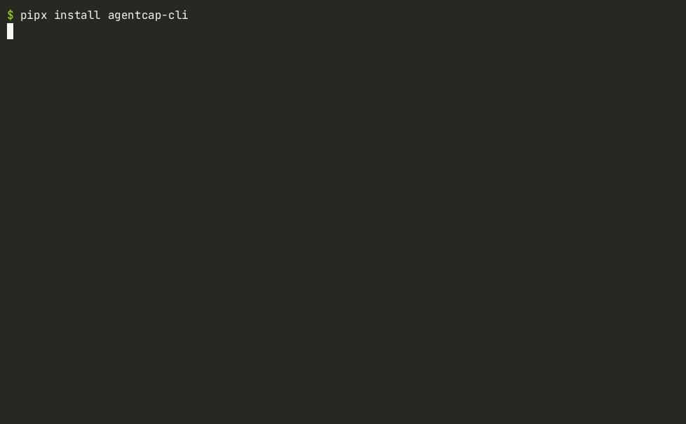
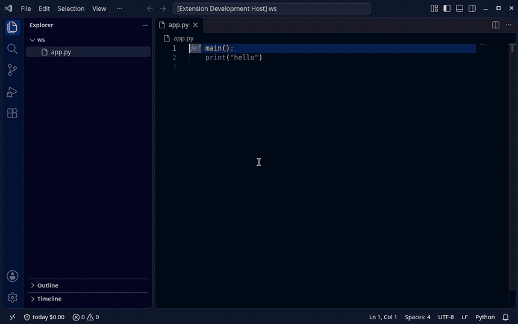

# AgentCap

**Stop Claude Code and Codex runs that loop or eat your weekly quota.** AgentCap stops a run
that repeats the same tool call or keeps failing, and stops a job at its share of your
Claude Max/Pro or ChatGPT weekly / 5-hour quota, with an evidence receipt of why. Free
`agentcap waste` shows where your tokens already went: subagents, Opus, cache misses,
tool loops and error streaks.

```text
$ agentcap waste --since 7d
SUBAGENTS                $41.20    25% of spend  in 31 subagent/forked threads
OPUS                     $38.90    24% of spend
CACHE MISSES              $6.10  57 cache re-writes after the TTL ran out (5 min since the last request, or 1 h)
   main session     $2.30  21x    subagents     $3.80  36x
   Tip: idle subagents re-wrote their own context 36x (~$3.80). Set subagentPromptCacheTtl: "1h" ...
STARTING CONTEXT     31 subagents, first request median 38.2k tok, largest 131.0k (7f3a91c2/a1b2c3d4)
REPEATED TOOL CALLS       $9.80  12 streaks of >= 3 identical calls in a row
TOOL ERROR STREAKS        $4.30  5 streaks of >= 3 failing calls in a row
Pro would have stopped this run at $3.12 / at 4 repeats (Bash x11 in 7f3a91c2, $2.40 after that).
```
*(illustrative numbers; run it on your own logs, it is read-only)*

## Stop loops and quota burn (Pro)

```bash
agentcap run --quota 5% -- claude                 # subscription: stop at 5% of the weekly quota, or on a loop
agentcap run --quota 10% --window 5h -- codex     # same for Codex on a ChatGPT plan
agentcap run --cap 2 -- codex exec "fix tests"    # API key: $2 cap + loop/burn breaker
agentcap approve                                  # raise a stopped job's limit by 50% (at most twice)
```

On a $20/month Codex plan, two code-review prompts used the whole 5-hour limit
([Povilas Korop](https://x.com/PovilasKorop/status/2116114249655501050): $7.70 + $1.43 at API prices).
`--quota 10% --window 5h -- codex` stops the job before that.

Free tools like [claude-code-spend-stop](https://github.com/VedantBhayani/claude-code-spend-stop) and
[RelayPlane](https://relayplane.com) give you a free $ cap. AgentCap adds the loop breaker, a cap on
your subscription quota % and Codex support.

- **Loop breaker.** Same tool call (name + input) 4 times in a row, or 8 failing tool calls in a
  row: the run is stopped (exit 4). On subscriptions it works without touching your login or
  traffic: Claude Code via an official `PreToolUse` hook (denies the 4th identical call and ends
  the turn; an interactive session stays open so you can `agentcap approve` or quit; headless
  `claude -p` runs get SIGINT if they keep going); Codex by reading its own rollout file (SIGINT). On API keys the
  proxy also catches identical requests and `--max-burn` $/min spikes.
- **Per-job quota %.** Stop one job at its share of the account's weekly or 5-hour limit.
- **Evidence receipt.** Each stop prints and saves why (`same tool call 4 times in a row (Bash)`,
  `this job used 5.1% of the weekly quota`) and the last tool call's name, as numbers and tool
  names only, never prompts or tool inputs.
- **Approve.** After a stop, `agentcap approve` (or `/agentcap:approve` in the plugin) raises the
  limit by 50%, at most twice, and the run continues. This works for interactive Claude Code,
  which stays open after a stop. Codex and headless `claude -p` jobs are stopped with SIGINT, so
  there approve only helps before the limit is hit; after a stop it says so and changes nothing.
- **Free** runs the same detectors in observe-only mode and prints what Pro would have done.

Honest limits: Claude tool-error streaks are only caught on API-key runs (the subscription hook sees
the call, not its result); the stop can be one request late; quota % is account-level; verified on
fixtures, fake CLIs and real Claude Code 2.1.197 hooks, **not yet on a real Max/ChatGPT account.**

## The API-key cap

AgentCap runs
the CLI behind a local proxy on `127.0.0.1` and applies a local spend cap to the
run. Before each request it reserves the worst-case cost; when the budget is gone
it kills the local process and tells you why. No dashboard, no account, no code
changes for tools that honour a base-URL environment variable.

Claude Code and Codex CLI are routed automatically (Gemini CLI too). AgentCap meters API-key
traffic — `POST /v1/responses` and `/v1/chat/completions` (Codex CLI uses the
Responses API) plus Gemini `generateContent` / `streamGenerateContent` and Anthropic `POST /v1/messages`. ChatGPT
or Google sign-in (OAuth/subscription) traffic is not metered.

## What it is

AgentCap is a small, local, serverless spend-cap proxy. You give it a command
and a cap:

```bash
agentcap run --cap 2 -- codex exec "fix the failing tests"
```

Everything the child sends to OpenAI or Gemini is routed through a proxy on
`127.0.0.1`. AgentCap reserves the worst-case cost of each request before it is
forwarded, settles the real usage afterwards, and terminates the agent's process
group if the cap would be exceeded. This is a local spend cap, not a
mathematical guarantee: with conservative reservation it reserves worst-case
cost before each request, so overshoot is rare but possible when providers count
more tokens than estimated.



*Simulated demo — fake local API, no key, no money.*

## Install

The package is published on PyPI as `agentcap-cli` (the name `agentcap` is
taken), but the command it installs is still `agentcap`.

```bash
# install the command globally
pipx install agentcap-cli

# or into the current environment
pip install agentcap-cli
```

No pipx? macOS: `brew install pipx && pipx ensurepath`; Linux: `python3 -m pip install --user pipx && python3 -m pipx ensurepath`.

From a checkout:

```bash
uv venv .venv
uv pip install -e .

# or install this checkout as the global command
pipx install .
```

## Install in VS Code / Cursor

The **AgentCap** editor extension (0.2.0) starts Claude Code or Codex in an
integrated terminal behind `agentcap run --cap`, shows live run spend in the
status bar, warns at 80% / 95%, and shows a modal when the cap (exit 3) or Pro's
loop breaker (exit 4) stops the run. It needs the `agentcap` CLI above.

It is **not on the VS Code Marketplace or Open VSX yet**. [Download agentcap-0.2.0.vsix](https://agentcap.launchbench.studio/agentcap-0.2.0.vsix)
(sha256 `175213b0979019cb472752ad71e613a48c6a22e7d899b761093ab7eac9867e70`) and install it:

```bash
curl -LO https://agentcap.launchbench.studio/agentcap-0.2.0.vsix
sha256sum agentcap-0.2.0.vsix   # compare with the sha256 above
code --install-extension agentcap-0.2.0.vsix     # VS Code
cursor --install-extension agentcap-0.2.0.vsix   # Cursor
```

or *Extensions → … → Install from VSIX…*. Then run **AgentCap: Start Codex
with cap** (or Claude Code) from the command palette; set the cap with
**AgentCap: Set cap**.



*Real VS Code recording; the agent is a fake Codex script talking to AgentCap's
local fake upstream, so no real API call or spend is involved.*

## Quickstart

```bash
# Codex CLI under a $2 cap (API-key mode: uses OPENAI_API_KEY)
agentcap run --cap 2 -- codex exec "fix the failing tests"

# Gemini CLI under a $2 cap (API-key mode: uses GEMINI_API_KEY)
agentcap run --cap 2 -- gemini -p "refactor utils.py"

# Gemini CLI in a folder you have not trusted yet
agentcap run --cap 2 --trust-workspace -- gemini -p "refactor utils.py"

# Run your own Python agent (it must honour OPENAI_BASE_URL)
agentcap run --cap 1 -- python my_agent.py

# Keep a proxy open for several terminals
agentcap serve --port 8787 --cap 5

# Simulated, fully local demo (fake API, no key, no money)
agentcap demo

# Inspect spend
agentcap status --port 8787
agentcap status --db

# Inspect the bundled price table
agentcap pricing
agentcap pricing google/gemini-4-argon
```

Uses your API key (`OPENAI_API_KEY` / `GEMINI_API_KEY`). ChatGPT or Google
sign-in (OAuth/subscription) traffic is not metered.

`agentcap run` accepts `--cap` (default `$5`, or `$AGENTCAP_CAP`),
`--hour-cap` / `--day-cap` and `--max-burn` (Pro), `--allow-unmetered`, `--no-clamp`, `--port`,
`--trust-workspace` and `--quiet`.

### CLI routing

- **Codex CLI 0.163** ignores `OPENAI_BASE_URL`, so AgentCap passes
  `-c model_provider=agentcap` and a `model_providers.agentcap` block (Responses
  API over HTTP, websockets disabled) right after the executable. If your command
  already sets `model_provider`, `model_providers.*` or `openai_base_url` with
  `-c`/`--config`, AgentCap refuses to start (exit code 2) rather than let
  traffic bypass the proxy.
- **Gemini CLI 0.58–0.66** needs an auth type in headless mode, and from 0.60 it
  also refuses system settings files that are not root-owned. AgentCap therefore
  runs Gemini with a temporary `GEMINI_CLI_HOME`: its `.gemini` directory links
  your real entries (history, `trustedFolders.json`, credentials) and holds a
  copied `settings.json` with the auth type forced to `gemini-api-key`. The
  overlay is removed afterwards; nothing in your real `~/.gemini` is modified.
  `--trust-workspace` adds `GEMINI_CLI_TRUST_WORKSPACE=true` for Gemini.
- `npx @openai/codex ...` and `npx @google/gemini-cli ...` are recognised too.

Add `--trust-workspace` for Gemini CLI runs in folders you have not trusted yet;
without it, headless Gemini may refuse the workspace.

At the end of a run AgentCap warns **“no model requests observed — protection
not verified”** if the proxy saw no model traffic. That means the agent may have
bypassed the proxy, so check the command and auth mode.

## Claude Code (new in 0.1.5)

```bash
export ANTHROPIC_API_KEY=sk-ant-...
agentcap run --cap 3 -- claude -p "fix the failing tests"
# Pro: agentcap run --cap 3 --hour-cap 10 --day-cap 25 -- npx @anthropic-ai/claude-code -p "..."
```

AgentCap points Claude Code at its local proxy (`ANTHROPIC_BASE_URL=http://127.0.0.1:<port>/anthropic`)
and meters every `POST /v1/messages`, streamed or not:

- Prices come from Anthropic's published table (docs.claude.com pricing, checked 2026-10-30):
  input, cache reads, 5-minute cache writes (1.25x input), 1-hour cache writes (2x input) and output.
  Thinking tokens are billed as output and are covered by `max_tokens`.
- Before a request goes out, AgentCap reserves its worst case (`max_tokens` of output, all prompt
  tokens as 1-hour cache writes). If that does not fit the remaining budget it lowers `max_tokens`
  (and a manual thinking budget) or refuses the request. It never raises a limit.
- Unknown models, unknown `inference_geo` values and fast mode (`speed: "fast"`, not priced yet) are
  blocked (fail-closed). `inference_geo: "us"` is charged at 1.1x.
- `count_tokens` and `GET /v1/models` pass through for free. Other Anthropic endpoints are blocked
  unless you pass `--allow-unmetered`.
- AgentCap refuses to start Claude Code when `CLAUDE_CODE_USE_BEDROCK`, `_VERTEX` or `_FOUNDRY` is set,
  or when a Claude settings file sets its own `ANTHROPIC_BASE_URL` in `env`. Those would send
  traffic around the cap.

Limits:

- With a Claude subscription login instead of an API key, the cap counts API-list-price
  equivalents, not your plan's billing.
- Costs are estimates from provider-reported usage. Your Anthropic invoice is authoritative.
- A large first request needs a cap that fits it. Claude Code's first request often reserves
  about $0.50–$1. AgentCap prints a suggested `--cap` when it refuses one.

## Install as a Claude Code plugin (Max / Pro subscriptions)

The easiest path on a Claude Max or Pro plan. Inside Claude Code:

```
/plugin marketplace add Blitz00X/agentcap
/plugin install agentcap@agentcap
/agentcap:setup          # once: adds AgentCap's read-only statusLine (your own line keeps showing)
/agentcap:quota 5%       # this session may use 5% of the weekly quota (`2% 5h` for the 5-hour window)
/agentcap:status         # session 3.1% / 5% (weekly)
/agentcap:off            # clear it;  /agentcap:unsetup restores your old statusLine
```

No pip install: the plugin is stdlib Python (`python3` on PATH). How it works:

- Claude Code only exposes the subscription `rate_limits` % to the **statusLine** command, and a
  plugin can't set the main statusLine. So `/agentcap:setup` asks once and writes it to
  `~/.claude/settings.json` (backup `settings.json.agentcap-backup`, previous line chained,
  `/agentcap:unsetup` undoes it).
- Plugin hooks: `PreToolUse` warns at 80% and, on **Pro**, denies tool calls at the limit;
  `Stop` prints a receipt (`session 4.2% / 5% (weekly)`). **Free:** live meter + one notice
  at the limit (`Pro would stop the agent here`). Pro is read from the licence the `agentcap`
  CLI stores after `agentcap license activate` (paste the key at the hidden prompt).
- Loop breaker (works with or without `/agentcap:quota`): `PreToolUse` hashes each tool call
  (name + input, per session and per subagent; polling tools like `TaskOutput`/`BashOutput`
  are ignored). The 4th identical call in a row is denied with `continue: false` on **Pro**;
  **Free** gets one notice per streak. `PostToolUse` / `PostToolUseFailure` count failing
  tool calls: 8 in a row stops the agent on Pro (`continue: false`), Free gets a notice.
  Tool input and output are never stored, only a 16-char hash and counts; these per-session
  files are deleted after 7 days (on `SessionStart`).
- Read-only: no OAuth token, credentials file or API traffic is touched.

Honest limits: the % is account-level (parallel sessions count), the stop can be one request
late, and the share updates when the statusLine refreshes. Verified with real Claude Code
2.1.197 (plugin install from the marketplace, hooks loaded, `/agentcap:quota` executed,
PreToolUse deny blocked the tool) against a local fake API and synthetic `rate_limits`;
**not yet checked against a real Max account.**

## Works with Claude Max / ChatGPT subscriptions (quota mode)

On a subscription there is no dollar bill, but there is a weekly and a 5-hour usage limit.
Quota mode caps **one job's share** of it:

```bash
agentcap run --quota 5% -- claude              # stop this job after 5% of the weekly quota
agentcap run --quota 10% --window 5h -- codex  # or 10% of the 5-hour window
agentcap quota                                 # read-only: last seen usage (Free)
```

- **Read-only, ToS-safe.** AgentCap never proxies, reads or reuses your subscription login
  or tokens, and never touches subscription traffic. The official, unmodified CLI talks to
  Anthropic/OpenAI directly.
- **Claude Code:** for this run only, AgentCap adds a settings layer with `claude --settings <file>`
  (your `~/.claude/settings.json` and project settings are never edited). It contains a
  statusline command that records the official `rate_limits` (`five_hour` / `seven_day`
  `used_percentage`, `resets_at`) and then runs **your own statusline command unchanged**,
  plus a `PreToolUse` hook that denies further tool calls with a clear reason once the job's
  share reaches the limit and ends the turn (`continue: false`). An interactive session stays open
  (run `agentcap approve` to continue, or quit); a session where the hook never fired gets
  SIGINT. Exit code 3. **Quota % is interactive-only:** headless `claude -p` exposes no usage %
  to AgentCap, so `--quota` warns and only the loop/error breakers are active there.
- **Codex CLI:** AgentCap tails the `token_count` events Codex writes to
  `~/.codex/sessions/**/rollout-*.jsonl` (`rate_limits.primary/secondary.used_percent`,
  `window_minutes`, `resets_at`) and sends SIGINT at the limit. Exit code 3.
- Baseline at job start (exact when a reading from the last 15 minutes exists, otherwise the
  first response is not counted), window resets mid-job are handled, 80% warning,
  per-job receipt: `this job used 4.2% of the weekly quota`. Pro alerts (Telegram/webhook)
  and receipt files work the same as for dollar caps.
- **Free:** `agentcap quota` and observe-only runs that print the job's share and
  `Pro's quota mode would have stopped this job at 5%`. **Pro:** stopping at the limit.

**Honest limits.** The percentage is **account-level**: a parallel session or claude.ai/chatgpt.com
use in the same window counts against the job (AgentCap warns when it sees another session).
Values arrive once per model response, so a job **can overshoot by up to one request**.
Claude Code only reports `rate_limits` for Pro/Max logins and only in interactive sessions
(the statusline does not run in `claude -p`). Codex's rollout format is undocumented and may change. Codex reports `used_percent` in whole percent, so a Codex cap under 1% cannot trigger until the job has used a full 1% (AgentCap warns at start). Use `--quota 1%` or more for Codex.
Claude Code reports whole percents too: a cap under 1% trips at the next 1% step (AgentCap warns).
Verified on real accounts: see the harness support matrix under "Supported & tested".

## opencode and agy (Antigravity CLI)

Headless runs only. AgentCap reads each agent's own event stream; nothing is proxied in these modes.

```bash
# opencode Go (or any opencode provider): token cap, loop + error breakers
agentcap run --tokens 200000 -- opencode run -m opencode-go/deepseek-v4.1-flash "fix the test"
# opencode: cap on opencode's own cost estimate
agentcap run --log-cap 0.50 -- opencode run -m opencode-go/glm-5.3 "..."
# agy on a Google subscription: real quota % from `agy -p /quota`
agentcap run --quota 2% --window 5h -- agy --model gemini-3.8-flash-low -p "..."
# $ APIs through the proxy (OpenRouter shown)
AGENTCAP_OPENAI_UPSTREAM=https://openrouter.ai/api OPENAI_API_KEY=$OPENROUTER_API_KEY \
  agentcap run --cap 0.50 -- opencode run -m agentcap/<openrouter model id> "..."
```

opencode does not expose subscription quota %, so `--quota` is refused for it; use `--tokens` or `--log-cap`. `--log-cap` trusts opencode's price table, not AgentCap's.

## Try it without an API key

`agentcap demo` is a simulated demo. It starts a fake API on a random loopback
port, runs a tiny child against it with a 5-cent cap, and prints `(simulated)` at
the end. It needs no API key, makes no real provider calls, and works from a
plain `pipx install agentcap-cli`. Exit code `3` means the cap stopped the child.

### Simulated demo (fake local API, no real money)

```text
$ agentcap demo
SIMULATED DEMO — fake local API, no real provider, no real money. Dollar amounts are simulated.
agentcap [run-3bc1257940cb]: 50% of the $0.05 run cap used ($0.0252).
agentcap [run-3bc1257940cb]: 80% of the $0.05 run cap used ($0.0408).
agentcap [run-3bc1257940cb]: budget low, limiting output to 15303 tokens per request
agentcap [run-3bc1257940cb]: RUN CAP HIT (scope=run, cap=$0.05, spent=$0.0499). Stopping the agent.
agentcap run summary
  run id: run-3bc1257940cb
  requests: 44
  refused requests: 2
  spent: $0.0500
  cap: $0.05
  reserved-but-unsettled: $0.0000
  clamped requests: 8
  reason: cap_exceeded
  exit code: 3
(simulated)
```

From a checkout, `python -m agentcap.devtools.fake_upstream --port 9000` still
starts the bundled fake upstream on loopback for manual metering experiments; the
test suite uses `httpx.MockTransport` and never calls the network.

## Supported & tested

| Tool | Verified version | Command and auth | Routing |
| --- | --- | --- | --- |
| Codex CLI | 0.163 | `codex exec "…"` with `OPENAI_API_KEY`; ChatGPT sign-in is not metered. | Automatically, via an injected custom provider (`-c model_provider=agentcap …`). |
| Gemini CLI | 0.58–0.66 | `gemini -p "…"` with `GEMINI_API_KEY`; Google sign-in is not metered. | Automatically, via a temporary `GEMINI_CLI_HOME` overlay (your `~/.gemini` is linked, its `settings.json` is copied with the auth type forced to `gemini-api-key`; nothing in `~/.gemini` is modified). Add `--trust-workspace` to `agentcap run` for untrusted folders. |
| Claude Code | 2.1.197 | `claude -p "…"` with `ANTHROPIC_API_KEY`; Claude subscription sign-in is not metered. | Automatically, via `ANTHROPIC_BASE_URL`. Tested end-to-end against a local fake Anthropic API only (not against Anthropic billing yet). |
| Your own script | Any | Uses the OpenAI or Gemini SDK with base-URL environment variables. | No code changes: AgentCap sets `OPENAI_BASE_URL`, `GOOGLE_GEMINI_BASE_URL` and `ANTHROPIC_BASE_URL`. |

Tested with a real Gemini API key on Gemini CLI 0.66 (spend metered from Google's
usageMetadata, output clamped to the cap). Codex CLI 0.165 verified against real
OpenAI-compatible upstreams: Ollama Cloud (gpt-oss:20b) and OpenRouter (free model
poolside/laguna-s-2.1:free via the Responses API) — real responses, ledger token counts
matched OpenRouter's reported usage exactly, cap stop with exit 3; not against OpenAI
billing. Gemini CLI 0.58 and Codex CLI 0.163 are tested end-to-end against a local fake API only.

Models without a bundled price (for example OpenRouter or Ollama ids) are blocked until you add a price via `AGENTCAP_PRICING_FILE`.

### Harness support matrix (real runs)

Legend: ✅ verified on a real account/endpoint · ⚠️ works with a limitation · ❌ not supported · **needs X** = untested, X blocks it.

| Harness + auth | Loop breaker (4x same call, exit 4) | Error breaker (8 failures, exit 4) | Quota % stop (exit 3) | $ / token cap |
| --- | --- | --- | --- | --- |
| Claude Code, Pro/Max sub, interactive | ✅ (deny keeps the session; resumes after approve) | ✅ | ✅ whole-% steps (deny keeps the session); `agentcap approve` ✅ | ❌ by design (no proxy on a subscription login; AgentCap refuses) |
| Claude Code, Pro/Max sub, headless `claude -p` | ✅ (exit 4) | ✅ (exit 4) | ❌ interactive only (warns at start) | ❌ by design (refused) |
| Codex, ChatGPT sub | ✅ | ✅ | ✅ (whole %; warns under 1%) | ❌ by design (no proxy on a subscription) |
| opencode Go | ✅ | ✅ | ❌ opencode exposes no quota % | ✅ `--tokens`; `--log-cap` uses opencode's own price table |
| agy, Google sub (plain `agentcap run -- agy` needs no key: breakers only) | ✅ | ✅ | ✅ (tested at 0.5%; ~10 s polling, can overshoot) | ❌ (sub); $ only via Gemini API |
| opencode + OpenRouter (free model) | ✅ | ✅ | n/a | ✅ $ cap |
| opencode + Ollama Cloud | ✅ | ✅ | n/a | ⚠️ needs a user price (`AGENTCAP_PRICING_FILE`): Ollama publishes none |
| Codex + Ollama | ✅ (exit 4 on 4th identical exec) | ✅ | n/a | ✅ $ cap (user price) |
| Codex + OpenRouter | ✅ (exit 4 after 4 identical steps in a row; Codex 0.166, free model, 5 Nov 2026) | ✅ (exit 4 on the 8th failing command) | n/a | ✅ $ cap stop (earlier release run, free model); a rejected key stops with `upstream_auth_failed` (exit 2) |
| agy + Gemini API | **not provable on a free key**: agy sends >5 req/min and exits on the first 429 (no retry); needs a paid key | same | n/a | ✅ $ cap (exit 3) |
| Claude Code + `ANTHROPIC_API_KEY` | **needs an Anthropic API key** (proxy path; only a local fake API so far) | **needs an Anthropic API key** | n/a | **needs an Anthropic API key** |

Tested with Claude Code 2.1.316 on a real Claude Pro login (Haiku) and an activated AgentCap Pro
license, through the CLI, 1 Nov 2026. 429/5xx retries (identical resends) are counted neither as loops nor as failing tool calls.

Known limits: quota % is account-level (parallel sessions count); Claude/Codex report whole
percents; interactive Claude turns with no tool calls can't be denied, so after a 30 s grace
period AgentCap sends SIGINT and the session ends; Codex's sandbox can't run commands on Ubuntu 24.04 by default:
`kernel.apparmor_restrict_unprivileged_userns=1` blocks bubblewrap's user namespace
(host setting, not AgentCap; Codex falls back or needs an AppArmor profile for bwrap).

**Platforms:** Linux and macOS. Windows: not yet (use WSL2).

## How it works

1. `agentcap run` starts the proxy on a random free port, bound **only** to
   `127.0.0.1`, and waits for `/_agentcap/status`.
2. The child process is started in its own process group with:

   ```text
   OPENAI_BASE_URL=http://127.0.0.1:PORT/openai/v1
   GOOGLE_GEMINI_BASE_URL=http://127.0.0.1:PORT/gemini
   GEMINI_API_BASE_URL=http://127.0.0.1:PORT/gemini
   AGENTCAP_RUN_ID=...
   AGENTCAP_PROXY=http://127.0.0.1:PORT
   ```

3. Before forwarding a request, the proxy estimates the prompt size and the
   maximum output size, then atomically reserves that worst-case USD amount in
   a local SQLite ledger. The input estimate is padded by a conservative
   `input_safety_factor` (1.25 by default) to cover system prompts, tool
   schemas, images and tokenizer differences that the local estimate cannot
   see. Concurrent requests reserve against the same budget.
4. After the upstream responds, the real usage is parsed and the reservation is
   settled to the actual cost (rounded up to the micro-dollar). Settlement uses
   the provider's reported tokens, never the padded estimate. If the provider
   bills more input tokens than estimated, that one settlement can exceed its
   reservation; AgentCap emits an `overshoot` alert and the run's spend may end
   slightly above the cap.
5. If the worst case does not fit the remaining budget but the prompt itself
   does, the proxy **clamps the output limit** to exactly what fits (at least
   `256` tokens by default) and reserves only that amount. The agent keeps
   running; real usage still settles the reservation. Clamping is on by default
   and can be disabled with `--no-clamp`.
6. If even a minimal clamped request cannot fit, the request is blocked and the
   whole child process group is terminated. In proxy (`--cap`) mode that is
   `SIGTERM`, then `SIGKILL` after 5 s. Quota and harness (`--quota`,
   `--tokens`, `--log-cap`) modes use `SIGINT` → `SIGTERM` → `SIGKILL`
   (5 s / 3 s / 2 s) so a headless agent can end its turn; both paths are
   described under "Stopping, fail-closed and self-approval". `agentcap run`
   exits with code `3`. Pro's loop/burn breaker exits
   with `4` (same step 4 times in a row, 8 failing tool results in a row, or a
   burn rate above `--max-burn` $/min; see Free vs Pro).
   The kill and its red alert fire at most once per run; later rejected
   requests just receive `429` responses.
7. Unknown models and unparseable bodies are rejected (fail-closed); the request
   is never forwarded unmetered.

The proxy makes only two kinds of request-body change: it adds
`stream_options.include_usage` to OpenAI Chat Completions streams so final
usage is available, and (unless `--no-clamp` is given) it lowers the request's
output limit when the worst-case reservation would cross the remaining budget.
For OpenAI that is `max_completion_tokens` (or the legacy `max_tokens` if the
body already used it) or `max_output_tokens` for the Responses API; for Gemini
it is `generationConfig.maxOutputTokens`. An existing smaller limit is never
raised. Everything else is forwarded byte-for-byte, including credentials.

Reasoning/thinking tokens are billed as output and count against the same
output limit, so a clamp also caps them.

### Exit codes

`agentcap run` uses the same codes in `--cap`, `--quota`, `--tokens` and
`--log-cap` modes (0.3.1). Otherwise it returns the agent's own exit code.

| Code | Meaning |
| --- | --- |
| `2` | Setup or auth refusal: bad flags, a Pro-only flag on Free, a conflicting CLI config, a second quota job, the provider rejected the credentials (`upstream_auth_failed`), or it refused the request for another reason (`upstream_refused`). |
| `3` | A cap stopped the agent (`--cap`, `--quota`, `--tokens`, `--log-cap`). |
| `4` | Pro's loop/error/burn breaker stopped the agent. |
| `5` | Internal error: AgentCap could not use its own state (HOME, `quota.lock`, ledger, license or job files), its proxy could not start, an opencode/agy log schema or Codex rollout log could not be read (fail-closed), or AgentCap hit an internal fault. The message names the failed action and path (`internal state error: could not open the quota lock ...`); the agent was not started, or was stopped (reason `internal_error`). |
| `127` | The command itself could not be started (not found, not executable): `could not start the command (...)`. |

## Metered endpoints

| Provider | Endpoints |
| --- | --- |
| OpenAI | `POST /v1/chat/completions`, `/v1/responses`, `/v1/completions`, `/v1/embeddings` |
| Gemini | `generateContent`, `streamGenerateContent` (other Gemini endpoints pass through) |

Token counting (`countTokens`) and `GET` requests are free passthroughs.
Request bodies are billed at price-book rates; embeddings are input-only.

## Limitations

- Tools that AgentCap can route (Codex CLI, Gemini CLI) or that honour
  `OPENAI_BASE_URL` / `GOOGLE_GEMINI_BASE_URL` and send API keys can be metered.
  OAuth or subscription logins are **not** metered.
- Prices are a local table, not a live feed. Check them with
  `agentcap pricing`; override any entry in
  `~/.config/agentcap/pricing.json` (or `$AGENTCAP_PRICING_FILE`).
- The proxy rewrites a request only to add `stream_options.include_usage` to
  OpenAI chat streams and, unless `--no-clamp` is set, to lower its output
  limit to what the remaining budget can afford. Prompts are never changed.
- Estimates are deliberately conservative, so a reservation can be larger than
  the eventual cost. The cap is enforced before each request with a worst-case
  reservation and concurrent requests reserve against the same budget. This is
  not a mathematical guarantee: if a provider bills more input tokens than
  estimated (for example server-side system prompts, tool schemas, images or
  tokenizer differences), the final spend can exceed the cap by that one
  request's estimation error. AgentCap emits an `overshoot` alert when a
  settlement exceeds its reservation.
- The ledger lives at `~/.local/state/agentcap/ledger.sqlite3`
  (override with `$AGENTCAP_DB`).

### Stopping, fail-closed and self-approval (0.3, Linux-verified)

- **Whole process tree.** A quota/harness stop (`--quota`, `--tokens`, `--log-cap`) sends SIGINT
  to the agent's process group, then SIGTERM, then SIGKILL (5 s / 3 s / 2 s); a proxy (`--cap`)
  stop sends SIGTERM, then SIGKILL after 5 s. Helpers the agent left behind in its group are also killed after a
  normal exit, so a dev server started by the agent does not outlive the run.
  On Linux AgentCap also enables `PR_SET_CHILD_SUBREAPER` for the run: descendants that call
  `setsid()` or double-fork are adopted, matched against a pre-run snapshot (PID + start time),
  and swept with SIGTERM then SIGKILL after a normal exit or a stop. It prints
  `killed N process(es) that left the agent's process group` when that happens. A descendant it
  may not signal (a root-owned `sudo -b` child, a setuid program) is tried once, not waited on, and
  left running with a `could not stop N process(es) (permission denied): pid ...` warning. Daemons the agent
  starts (a dev server, a `tmux` server, a Gradle daemon) are part of its tree and stop with the run.
  If AgentCap itself is SIGKILLed or OOM-killed, the parent-death lifeline (`PR_SET_PDEATHSIG`)
  kills the direct agent and a small watchdog SIGKILLs the agent's process group, which also covers
  a real agent started by a launcher (Codex's npm wrapper on Node without `process.execve`) and
  the agent's tool processes.
  Limits: on non-Linux only the process group is cleaned and there is no lifeline. A process that
  left the agent's group (`setsid`/daemonized) before AgentCap itself was SIGKILLed can still
  escape: no userspace process can clean up after its own SIGKILL. Use a container/cgroup or a
  separate OS user when the agent is not trusted. Adopted helpers that exit during a run stay
  zombies until it ends (the agent's group is reaped once the agent exits, the rest by the final
  sweep): `/proc` cannot tell an adopted `setsid` helper from a child AgentCap's own process
  started in a new session, and taking that child's exit status would make it report 0. A long
  run whose agent keeps leaving short-lived detached helpers holds one PID per finished helper,
  counted against `ulimit -u`, until the run ends. Opt-in (0.3.1, default off):
  `AGENTCAP_COLLECT_ZOMBIES=1` reaps, about once a second during the run, adopted zombies whose
  session id is neither AgentCap's nor their own pid (an in-group background job, a double-forked
  daemon), after re-checking their PID + start time. The agent, `setsid` helpers (session leaders)
  and AgentCap's own children are never reaped early, so their exit codes are kept; `setsid`
  helpers are still collected by the final sweep. Interrupting a job
  can leave its work half done (a migration, a deploy): that is the job's responsibility, so
  commit before a guarded run.
- **Fail-closed.** On Pro, quota and harness runs (`--quota`, `--tokens`, `--log-cap`) stop the
  agent with exit code 5 instead of letting it run unguarded when opencode/agy output matches no
  known log schema, the Codex session log becomes unreadable, or AgentCap itself hits an internal
  error; Free only warns about these. In `--cap` mode an internal AgentCap error stops the agent
  too, with exit code 5 and reason `internal_error` (since 0.3.1; see "Exit codes"). Two quota jobs at once are refused on Free and Pro (exit 2),
  since the quota % is account-wide; `AGENTCAP_ALLOW_PARALLEL=1` turns that lock off.
  Not covered yet: a stale Claude statusline (no fresh `rate_limits`) is reported, not stopped.
- **Rejected credentials (`--cap` proxy mode).** When the provider answers HTTP 401, 402
  (OpenRouter: no credits), 403, or Gemini's 400 `API_KEY_INVALID`, AgentCap prints
  `upstream rejected the request (HTTP 401: User not found.) — check the API key for <host>;
  nothing was spent.` (the provider's short `error.message`, truncated, key-shaped text redacted,
  headers never read). The agent's resends of such a request never count toward the loop breaker.
  After 3 rejections in a row with no other answer between them, the run is stopped on Free and Pro
  with reason `upstream_auth_failed` and exit 2 (like AgentCap's other exit-2 refusals: a setup
  problem to fix, rerunning unchanged cannot help). 429/5xx answers in between neither count nor
  break the streak, so 401/429/401/429/401 still stops. A 403 whose body is not about the key,
  permission or account (a region/country block, a moderation or policy refusal, or no readable
  body) is reported as `provider refused the request` instead, and three in a row stop the run with
  reason `upstream_refused` (exit 2). If the agent gives up first with a non-zero exit code, the
  reason is still `upstream_auth_failed`/`upstream_refused` and its own exit code is kept; if it
  exits 0, the reason stays `child_exit` and the rejection is printed as a separate warning. One
  rejection followed by a success changes nothing. `agentcap serve` only reports it and keeps serving.
- **Self-approval.** `agentcap approve` refuses (exit 2) when it runs inside an agent session
  (`AGENTCAP_QUOTA_JOB`, `AGENTCAP_GUARDED` or `CLAUDECODE` in its environment), and the hook of
  `agentcap run --quota -- claude` denies a Bash call that runs `agentcap approve`;
  `/agentcap:approve` cannot be invoked by the model (`disable-model-invocation`). Run approve
  from your own terminal. The Claude Code plugin's `PreToolUse` hook denies, on Free and Pro, any
  model tool call that would run its own script (`python3 .../scripts/agentcap_cc.py approve`,
  `quota`, `off`, `setup`, `unsetup`, `statusline`, `hook`; any path, `python -m agentcap_cc`,
  `import agentcap_cc`, an `agentcap*` glob, quoted/escaped/`$IFS` forms, inside `bash -c`/`sh -c`)
  or touch its state dir or installed plugin files: Bash and any other tool with a `command`, and
  Write/Edit/MultiEdit/NotebookEdit on those paths. Plain reads (`cat`, `grep`, `ls`, `jq`, ...;
  `git` without `-c`/config/checkout-style subcommands) still pass. Your own `/agentcap:approve`,
  `/agentcap:quota` and `/agentcap:off` keep working: Claude Code runs a slash command's `!` line
  without `PreToolUse` hooks (measured on 2.1.318, headless). When Claude Code's working
  directory is inside the plugin's own checkout, its code files stay editable (plugin development).
  What still passes: a command that never names the script or state dir (a script the agent
  writes elsewhere that builds the path at run time, `$(printf ...)` path pieces, other globs),
  and tools that execute code without a `command` field.
  **Honest limit:** the agent runs as your OS user, so a determined agent can still clear the
  environment, edit AgentCap's state files or kill AgentCap. AgentCap guards cooperative
  workloads against accidents (loops, runaway spend), not a hostile agent; use a separate OS
  user or container for that.
- **Log format changes.** AgentCap reads harness logs, and vendors change them. The fields it
  reads are pinned per harness in `agentcap/logschema.py` (opencode, agy, Claude Code statusline
  and PreToolUse, Codex rollout) and checked by `tests/test_log_contract.py` against recorded
  fixtures; `AGENTCAP_LIVE_CONTRACT=1 pytest tests/test_log_contract_live.py` re-checks the
  installed opencode/agy (one small model call). At run time an unknown schema fails closed
  (above). Last live check: opencode 2.2.4 (3 Nov 2026).

## Privacy

Prompts and keys pass through the local proxy in memory; AgentCap never stores
or uploads them. Free sends nothing anywhere. Pro sends alert metadata (run id,
spend, reason) only to webhook/Telegram destinations you configure, and
validates your licence key with Polar about once a week.

The ledger keeps token counts, costs, model names, timestamps and request
hashes — never prompts, response contents, API keys or Authorization headers.

**Pro licence checks:** activating a Pro key (and the periodic re-check) sends
only the licence key, the Polar organization id and an anonymous machine
fingerprint hash (SHA-256; it contains no hostname and no username) to Polar's
public licence API at `api.polar.sh`. Free users make no licence requests at
all.

## `agentcap waste` and usage history (Free, new in 0.2)

```bash
agentcap waste                       # subagent + Opus share, cache misses, tool loops, error streaks ($ each)
agentcap report --by agent           # session -> subagent tree with $ and Opus share
agentcap import                      # read-only: ~/.claude/projects, ~/.codex/sessions, AgentCap's ledger
agentcap report --by day             # Free: day | session | model | project, tokens + API-equivalent $
agentcap report --by model --since 7d --csv

agentcap budget set --task-usd 2 --day-usd 20 --task-quota 5% --window 5h
agentcap run -- codex exec "..."     # uses the $2 task cap from the budget
agentcap run --quota -- claude       # uses the 5% / 5h quota from the budget
```

Tools like agent-tree show you what your subagents are doing; AgentCap also stops them when they loop
(same tool call 4x in a row or 8 tool errors in a row, Pro). `agentcap waste` lists cache misses first:
resuming a session after the cache expired re-writes the whole prompt cache, so start a new session (or `/clear`) after a break.
Misses are split into main session and subagents. An idle subagent re-writes only its own context
(not the whole conversation, unless it is a forked subagent), at 1.25x normal input. If your
subagents sit idle for more than 5 minutes, set `subagentPromptCacheTtl: "1h"`. A 1 h write costs
2x input, so it only pays off when the subagent is reused. `STARTING CONTEXT` shows how many tokens
each subagent's first request carries.

- **Store:** `~/.local/share/agentcap/usage.db` (`$XDG_DATA_HOME` respected, mode 600). `import` is
  idempotent; it reads only `*.jsonl` session logs and AgentCap's own files. It never opens auth or
  credential files, never stores prompt or response text, and never touches network or OAuth traffic.
  Unknown or changed log lines are skipped and counted, not fatal.
- **Budget:** one file, `~/.config/agentcap/budget.json`. Scopes: task (one `agentcap run` = one agent
  session) in $, hour/day across runs in $ (Pro), and per-job % of the subscription quota (Pro stops).
  A flag or `AGENTCAP_CAP` always beats the budget. On Free, a budget hour/day cap is ignored with a note.
- **Early warning:** when the current burn rate would hit the run cap within ~10 minutes, AgentCap
  prints (and on Pro sends) one `cap_eta` alert: "cap is hit in ~N min".
- **$ is API-equivalent:** what the same tokens would cost at list API prices — not your subscription bill.
- **Subagents:** Claude Code `<session>/subagents/agent-*.jsonl` and `isSidechain` lines; Codex
  `session_meta` `source.subagent.thread_spawn.parent_thread_id` and `forked_from_id`. These formats
  are undocumented and change between CLI versions.
- **`waste` heuristics:** a cache miss is a cache write larger than the cache read after the prompt
  cache TTL ran out (5 min; 1 h when written with `ephemeral_1h`; Codex: a big uncached prompt after
  > 5 min idle). Its $ is what the re-write cost above a cache read: 5 min writes at 1.25x input,
  1 h writes at 2x input (Anthropic list prices). Tool inputs are hashed, never printed. Not in local logs: `agent_summary` / title
  background calls and HTTP retries (planned: local OTel receiver).

### Pro extras: analytics (`agentcap report <view>`)

| view | what you get |
| --- | --- |
| `forecast` | 5h / weekly quota: "limit hits at Tue 14:20 (~1.5h)", with an early-warning mark |
| `calibration` | "this week 1% of quota = 1.4M tokens ≈ $1.49", tracked per reset period so you can see if your limit shrank |
| `savings` | cache-write waste ($ of cache writes never read) and API-vs-plan breakeven with a plan recommendation (plan prices: `agentcap/plans.py`, override in `~/.config/agentcap/plans.json`) |
| `receipts` | per job / session / repo receipts, `--csv` export, plus AgentCap run receipts |

Calibration pairs quota % samples (Codex `rate_limits` in rollouts; Claude statusline readings recorded
during `agentcap run --quota`) with the tokens imported in the same window. It is an estimate; small %
steps are noisy. No team aggregation: everything stays on your machine.

## Free vs Pro (0.2)

**Free (MIT License, forever):** the per-run spend cap.
- Per-run `--cap` (`--hour-cap` / `--day-cap` exit 2 on Free with a clear message)
- Output clamping, fail-closed metering, terminal alerts
- Claude Code, Codex, any SDK script (and Gemini CLI)
- `agentcap waste`, `agentcap report --by agent` (subagent tree), `agentcap import`, `agentcap report` by day/session/model/project, `agentcap budget`, the `cap_eta` early warning

When the Pro detectors below would have fired on a Free run, AgentCap does not stop it.
It prints one line: `Pro's loop breaker would have stopped this at $X.XX`.

**Pro, $12 one-time (launch week; $19 after): stop runs that loop or eat your quota.**

**Get Pro:** buy at https://agentcap.launchbench.studio/#pricing (Polar checkout). Polar then
emails you an **Access purchase** link; the key is in the Polar customer portal (not in the
email body). Run `agentcap license activate`, paste the key at the hidden prompt, and check `agentcap license
status` (`tier: pro`). One key works on up to 3 machines; `agentcap license deactivate` frees one.
The VS Code/Cursor extension and the Claude Code plugin use the same CLI licence.

- **Subscription quota mode + loop breaker:** `agentcap run --quota 5% -- claude|codex` stops a job at
  its share of your Claude Max/Pro or ChatGPT quota, or when it repeats the same tool call 4 times /
  fails 8 tool calls in a row (see above).
- **API-key loop/burn breaker:** stops the agent (exit 4) before the next request is sent when
  (a) the same step repeats 4 times in a row (the last tool call + its result, normalised;
  the growing conversation history is ignored), (b) 8 consecutive tool results are errors, or
  (c) spend exceeds `--max-burn` USD/minute over a rolling 2-minute window (default `2.00`,
  `--max-burn off` disables). Byte-identical repeats are still caught too.
- **Hour and day caps:** cross-run `--hour-cap` and `--day-cap`.
- **Phone and webhook alerts:** Telegram (`AGENTCAP_TELEGRAM_BOT_TOKEN`, `AGENTCAP_TELEGRAM_CHAT_ID`)
  and webhook (`AGENTCAP_WEBHOOK_URL`) alerts for cap hits, loop kills and the end-of-run receipt.
  Tokens are read from the environment and are never printed or logged.
- **Extras — usage analytics:** `agentcap report forecast | calibration | savings | receipts` (see above).
- **Spend receipt:** a JSON file per run (`~/.local/state/agentcap/receipts/<run>.json`, or
  `AGENTCAP_RECEIPT_DIR`) with requests, spend, caps, the stop reason and the exit code. It contains
  numbers only, never prompts. The same one-line receipt is sent to Telegram and the webhook.

[Buy AgentCap Pro — $12 launch week](https://buy.polar.sh/polar_cl_qagsvUdwQ0dRvaW7X5ynEJg5md27pEctIRAr40MBeLi)

### Purchase terms

- Pro is $12 one-time (launch week; $19 after), no subscription. The current launch-week end date is on the pricing page.
- 14-day no-questions refund — email
  [kutaykarahan6@gmail.com](mailto:kutaykarahan6@gmail.com).
- One licence key activates on up to 3 machines.
- The key is checked with Polar about once a week.
- If the licence server is unreachable your Pro keeps working (fail-open); only
  an explicit Polar rejection of a refunded or revoked key downgrades it.
- If AgentCap is discontinued, Pro keeps working and you can ask for a refund
  within 14 days of purchase.
- The Free tier (per-run cap) needs no key and makes no network calls.

After purchase you receive a licence key by email (via Polar). Activate it with
`agentcap license activate` (paste the key at the hidden prompt). `agentcap license deactivate` asks the
license server to release this activation (freeing the slot for another
machine) and then removes the local license; if the server cannot be reached the
local license is kept and the command exits 1 so you can retry. Use
`agentcap license deactivate --local-only` to remove just the local file — the
activation then still counts toward your 3 machines until you release it in the
Polar customer portal.

## How it compares

| Tool | What it does and how it enforces a cap |
| --- | --- |
| RelayPlane | [relayplane.com](https://relayplane.com): free, MIT-licensed local proxy with daily/hourly/per-request/per-run caps, routing and a kill switch. It enforces budgets at the proxy — blocking or warning on breach — and is aimed at Anthropic/OpenAI chat routing. A good fit for gateway-style setups. |
| LoopGuard | [tryloopguard.com](https://tryloopguard.com): free MIT CLI that integrates with Claude Code, Codex CLI and Cursor (no proxy, works with subscriptions) with per-session/daily caps and a no-progress loop killer; paid tier ($9/month) adds phone/Slack alerts and remote pause. A good fit if you use subscriptions or Claude Code. |
| LiteLLM budgets | Budgets per key, user or team in the LiteLLM proxy; budgets need its database. A good fit if you already run a LiteLLM gateway; it is a server you deploy and configure. |
| OpenRouter credit limits / provider spend caps | Account- or key-level and typically monthly (OpenRouter credit limits, OpenAI and Google spend caps). Provider caps are evaluated with a delay — Google has described about 10 minutes for the Gemini API cap — so a fast loop can overshoot. |
| AgentCap | Local proxy for API-key traffic from Claude Code, Codex CLI, Gemini CLI or your own script: run cap (Free) with conservative reservation and output clamping, kills the process group at the cap and prints why. Pro (unattended pack): hour/day caps, loop/burn breaker, Telegram/webhook alerts, spend receipt, $19 one-time. |

The comparison above is from public pages; see the RelayPlane detail below.

## AgentCap vs RelayPlane

RelayPlane is a good tool. If it fits you, use it. The facts below come from RelayPlane's own
website as of 2026-10-30. We have not tested RelayPlane hands-on.

| | RelayPlane (per its site) | AgentCap |
|---|---|---|
| License | MIT | MIT License (the whole open-source CLI; Pro features are unlocked by a paid licence key) |
| Per-run / session / hour / day caps | Free | Run cap Free; hour/day caps Pro |
| Kill switch | Yes | Yes. Stops the agent's process group (exit 3) |
| Over-budget response | HTTP 429 `budget_exceeded` | HTTP 429, and the request is never sent |
| Output reservation | Capped at 4096 output tokens | Full `max_tokens` worst case, plus clamping to fit |
| Loop breaker | Not listed on their site | Pro |
| Telegram / webhook alerts, spend receipt | Not listed on their site | Pro |

The difference that matters for runaway bills: AgentCap reserves the worst case each request
can cost before sending it, so a single long response cannot overshoot the cap.

Pick what matches your setup — these tools can also be combined.

## FAQ

**Does clamping output hurt quality?** Yes, it can: when the budget is tight
AgentCap lowers max output tokens so the call fits; answers can be shorter or
cut off. Use `--no-clamp` to refuse instead.

**Does stopping roll back what the agent did?** No. At the cap AgentCap sends
SIGTERM then SIGKILL; files or remote changes already made stay. Use git / small
steps.

**Is the ledger my provider bill?** No. It is a local estimate from published
prices and reported usage; when usage is missing it charges the full reservation
(conservative). Your provider invoice is authoritative.

**Is the day cap shared across machines?** No. Hour/day caps are per machine
(local SQLite ledger). A license covers 3 machines, each with its own budget.

**What does one-time purchase include?** $12 once in launch week ($19 after), all 0.x updates; not a
promise of future major versions. 14-day refund window per purchase terms.

## License

MIT — see [LICENSE](LICENSE). Copyright (c) 2026 Kutay Karahan.

After purchase, copy your license key from your Polar order (purchase email / Polar customer portal), then run `agentcap license activate`, paste the key at the hidden prompt, and check with `agentcap license status` (expect `tier: pro`).

The Pro licence key is separate from the source licence. How it is checked:

- On activation the key is validated against Polar's public licence API
  (`api.polar.sh`). After that it is re-checked at most about once every 7 days.
- The result is cached in `~/.config/agentcap/license.json` (overridable with
  `$AGENTCAP_LICENSE_FILE`).
- The licence check fails open: if you are offline, or Polar cannot be reached,
  a previously validated licence keeps working. Network failures (timeouts,
  connection errors, 5xx, unexpected responses) never downgrade it, and
  revalidation is retried about every 7 days. Only an explicit rejection from
  Polar (for example a refunded or revoked key) falls back to the free tier.
- `AGENTCAP_POLAR_ORG_ID` selects the Polar organization the key belongs to.

## Development

```bash
uv venv .venv
uv pip install -e '.[dev]'
.venv/bin/pytest -q
```

Tests use mocked upstreams (`httpx.MockTransport`) and never make real network
calls; no real API keys are required.
